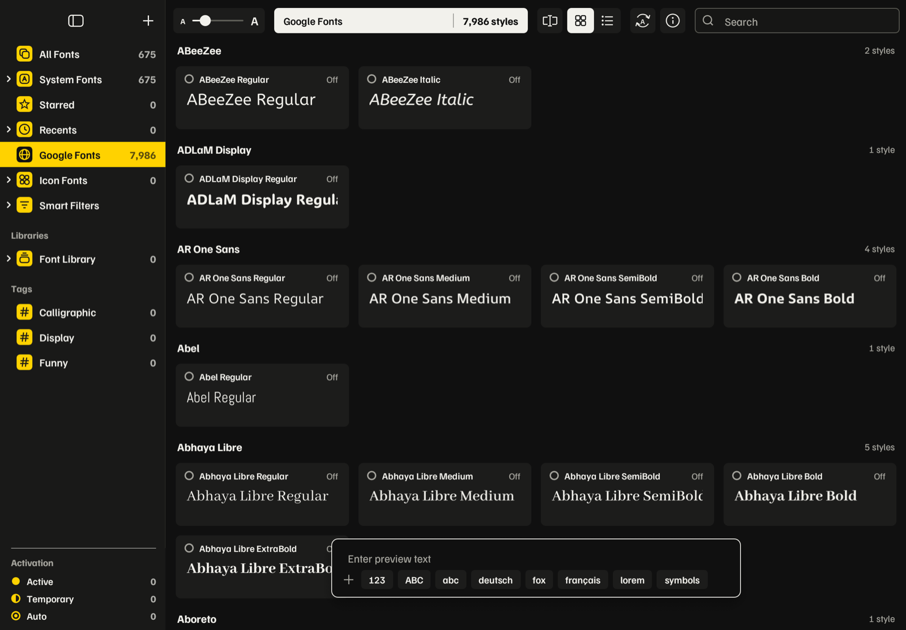
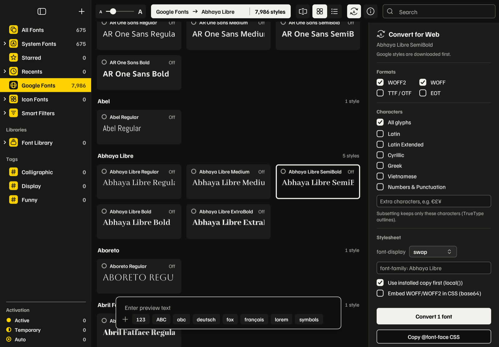
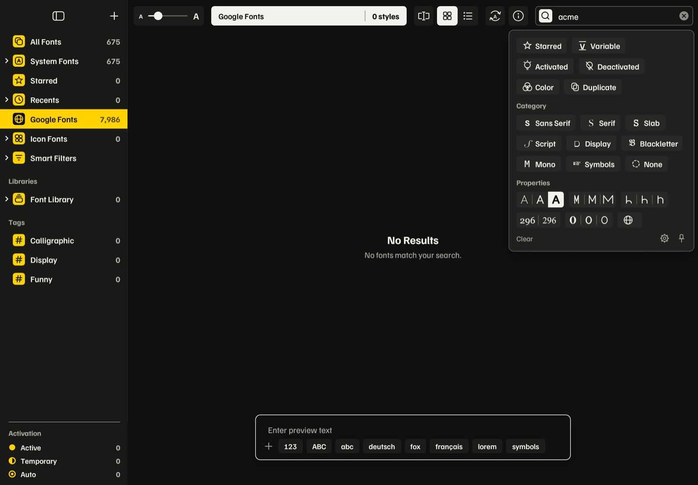

# Kernship

*Kerning + Spaceship: a command centre for your font galaxy.*

Kernship is a font manager for macOS. It browses, previews and organises your fonts,
switches them on and off for every design app, brings in the whole Google Fonts catalog, and
turns any font into web fonts with a ready `@font-face` stylesheet.



## What it does

- **Libraries, sets and tags.** Keep fonts in libraries (folders Kernship manages), group them
  in nested sets, label them with tags, and star the ones you come back to.
- **Smart filters.** Lists that fill themselves from rules: name, family, style, manufacturer,
  designer, licence, kind, category, activation, stars, variable fonts, libraries and tags.
- **Activation.** Click a font's status dot to switch it on for every app, or switch it on
  temporarily. *Check Missing Fonts* and auto activation switch on what the documents open in
  Adobe apps need.
- **Google Fonts.** The full catalog (about 1,900 families, 8,000 styles) is browsable before
  anything is downloaded. A style downloads when you activate or convert it.
- **Search with filters.** Under the search field: classification, weight, width, x-height,
  contrast, old-style figures, colour glyphs and language support, measured from the fonts
  themselves.
- **Convert for Web.** WOFF2, WOFF, TTF/OTF and EOT, subsetting by script or by your own
  characters, `font-display`, `local()` sources, base64 embedding, a demo page and a ZIP.
- **Icon fonts.** Icon sets shown as icons with their names: copy, save or drag any icon out as SVG.
- **Grid and list views**, preview text with ready samples, light and dark appearance, a
  menu bar icon, and updates that install themselves.



## Install

In Terminal:

```sh
curl -fsSL https://github.com/brainupstudio/kernship/releases/latest/download/install.sh | sh
```

The script picks the build for your Mac (Apple Silicon or Intel), checks it against the
published `SHA256SUMS.txt`, puts Kernship in Applications and opens it. Installed this way,
macOS opens it without the warning for apps from unidentified developers. The same command
updates an existing copy; your fonts, libraries and settings stay where they are.

To install somewhere else: `curl -fsSL …/install.sh | KERNSHIP_DIR=~/Applications sh`.

You can also download the disk image for your Mac from the
[latest release](https://github.com/brainupstudio/kernship/releases/latest). Downloaded from
the browser, the first time macOS says it cannot verify Kernship: press **Done**, open
**System Settings › Privacy & Security** and, at the bottom, press **Open Anyway**. Once only.

Requires macOS 11 or later.

## Updates

Once a day Kernship asks GitHub for the number of the latest release. When a new version is
out it downloads it, checks it against the published checksums and installs it when you quit
Kernship; **Restart to update** in the sidebar installs it at once. You can turn the check off
in **Settings › General › Updates**.

## Privacy

Kernship has no account and no analytics. It connects to the internet only for:

- the latest version number and the update itself, from GitHub;
- the Google Fonts catalog and the styles you download, from Google;
- the free icon sets you choose to download.

Your fonts, libraries and settings stay on your Mac.

## Where things are

| What | Where |
| --- | --- |
| Libraries (font files, sets) | `~/Kernship/Libraries` |
| Settings and the font index | `~/Library/Application Support/Kernship` |
| A downloaded update waiting to be installed | `~/Library/Caches/Kernship/update` |

## Guide

[docs/guide.md](docs/guide.md) explains the window, activation, libraries, smart filters,
web conversion and the keyboard shortcuts.



## Build from source

Kernship is written in Rust with [egui](https://github.com/emilk/egui). With
[rustup](https://rustup.rs) installed:

```sh
CARGO_RESOLVER_INCOMPATIBLE_RUST_VERSIONS=fallback cargo build --release
./target/release/kernship
```

`cargo test --release` runs the tests. `scripts/package-macos.sh` builds the app, the disk
images and the zips for Apple Silicon and Intel into `dist/`, with `SHA256SUMS.txt`;
`scripts/publish-release.sh notes.md` publishes them as a GitHub release.
[DESIGN.md](DESIGN.md) describes the visual system.

## License

[MIT](LICENSE). The interface typeface, Familjen Grotesk, is under the SIL Open Font License
(`assets/fonts/FamiljenGrotesk-OFL.txt`).
