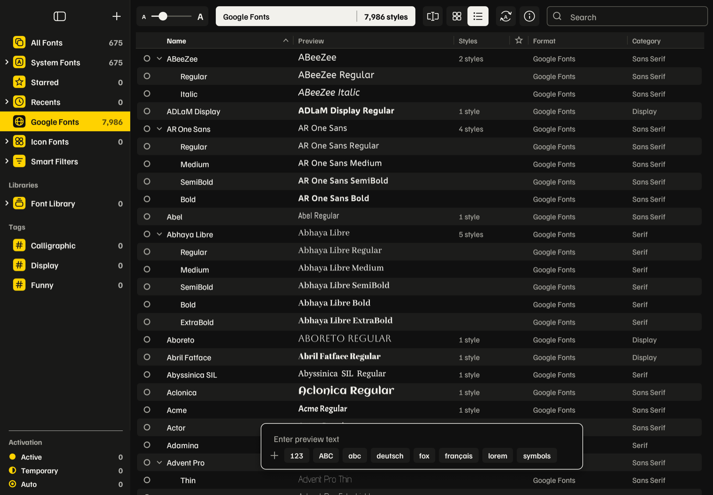

# Kernship guide

How Kernship is laid out and how to do the everyday things with it. For installing and updating
see the [README](../README.md).

## The window

- **Sidebar** (left): the sources. *All Fonts*, *System Fonts*, *Starred*, *Recents*,
  *Google Fonts*, *Icon Fonts* and *Smart Filters* at the top; then your **Libraries** with
  their sets, and your **Tags**. The foot counts the fonts that are on: *Active*, *Temporary*
  and *Auto*. Which sources show is set in **Settings › Sidebar**.
- **Toolbar**: the preview size, the current source and how many styles it holds, the grid and
  list views, **Convert for Web**, the **Info** pane and the search field.
- **Fonts**: families with their styles, as cards (grid, ⌘1) or as a table (list, ⌘2).
- **Preview text** (the bar at the bottom): type your own text, or pick a sample (123, ABC,
  abc, pangrams in several languages, lorem, symbols). ⌘E edits it.
- **Right pane**: *Info* about the selected font (version, designer, copyright, licence and its
  glyphs), or *Convert for Web*.

## Activating fonts

Every font has a status dot. A font that is **on** is registered with macOS, so every app
lists it at once: Adobe apps, Figma, Sketch, Affinity, Office, Keynote and the rest.

| | Menu | Shortcut |
| --- | --- | --- |
| Switch on until you switch it off (it stays on after a restart) | Font › Activate | ⌘R |
| Switch on until you log out | Font › Activate Temporarily | ⌥⌘R |
| Switch off | Font › Deactivate | ⇧⌘R |

Clicking the dot does the same as Activate and Deactivate. With **Activate entire font family**
(Settings › Auto Activation) one style switches on its whole family. A Google Fonts style is
downloaded the first time it is switched on.

**Auto activation.** When an Adobe app you enabled in **Settings › Auto Activation** is in
front, Kernship asks its open documents which fonts they use and switches on the ones it finds
in your libraries or in Google Fonts. **Check Missing Fonts** (Font menu, menu bar icon, or the
shortcut set in Settings) does the same once, on demand.

**Auto deactivation.** Settings › Auto Activation can switch auto-activated and manually
activated fonts off when Kernship quits.

## Libraries, sets and tags

- **Library**: a folder Kernship manages, kept in `~/Kernship/Libraries`. *File › New
  Library…* (⌘N) makes an empty one; *New Library from Folder…* (in the sidebar's + menu) makes
  one from a folder of fonts; *Open Library…* (⌃⌘O) adds a Kernship library from elsewhere.
- **Importing**: *File › Import Fonts…* (⌘O), *Add Folder…* (⌥⌘O), or drag files and folders
  onto the window. **Settings › Import** chooses whether the files are copied into the library,
  whether duplicates (same PostScript name) are skipped, whether imported fonts are switched on,
  and whether a dropped folder structure becomes sets.
- **Set**: a group of fonts inside a library; sets can hold sets. Drag fonts onto a set to add
  them. The library's menu (right-click in the sidebar) has *New Set…*, *Rename* and more.
- **Tag**: a label across libraries (*File › New Tag*, ⇧⌘N). **Star** a font to find it in
  *Starred*.
- **Recents** lists the fonts added in the last month, by Today, Yesterday, This Week and This Month.

## Smart filters

*File › New Smart Filter…* (⌥⌘N) builds a list from rules: name, family, style, manufacturer,
designer, copyright, licence, kind, category, activation, starred, variable, libraries and tags.
A smart filter updates itself as your fonts change. *Smart Filters* in the sidebar also has the
built-in lists: Activated, Auto Activated, Deactivated and Temporarily Activated fonts.

## Search

The search field (⌘F) matches names. When it has focus a panel opens under it with filters
measured from the font files: classification, weight, width, x-height, contrast, old-style or
lining figures, colour glyphs and the languages a font supports. Pin the panel to keep it open.

## Google Fonts

The whole catalog is listed before anything is downloaded, with its categories and the
languages each family supports. Styles download when you switch them on or convert them and
are kept in the *Google Fonts* library. **Settings › General › Google Fonts** sets how often
the catalog is refreshed; **Sync Now** refreshes it at once.

## Convert for Web

Select one or more fonts (from any source, Google Fonts included) and open **Convert for Web**
in the toolbar.

- **Formats**: WOFF2, WOFF, TTF/OTF, EOT.
- **Characters**: all glyphs, or a subset by script (Latin, Latin Extended, Cyrillic, Greek,
  Vietnamese, Numbers & Punctuation) plus any extra characters you type. Subsetting applies to
  TrueType outlines.
- **Stylesheet**: `font-display`, the `font-family` name, `local()` sources so an installed
  copy is used first, and WOFF/WOFF2 embedded in the CSS as base64.
- **Output**: the folder to save to, a demo page (`demo.html`) and a ZIP archive.

After the conversion Kernship shows how much smaller the WOFF2 is, and offers **Open Demo**,
**Show in Finder** and **Copy @font-face CSS**.

## Icon fonts

*Icon Fonts* shows icon sets as icons with their names. Download a free set (Google's Material
Icons) or drop an icon font (`.ttf` or `.otf`, with its `.css` for the names) onto the view.
Copy an icon as a character, a name, a Unicode value or SVG; save icons as SVG files, or drag
them out.

## Menu bar and background

With **Run Kernship in background** (Settings › General) closing the window (⌘W or the red
button) keeps Kernship in the menu bar. Click the icon to bring the window back; right-click it
for *Open Kernship*, *Check Missing Fonts*, *Settings…* and *Quit Kernship*. **Launch Kernship on startup** opens it when
you log in.

## Keyboard shortcuts

| Action | Shortcut |
| --- | --- |
| Settings | ⌘, |
| Import Fonts | ⌘O |
| Add Folder | ⌥⌘O |
| New Library | ⌘N |
| Open Library | ⌃⌘O |
| New Tag | ⇧⌘N |
| New Smart Filter | ⌥⌘N |
| Find | ⌘F |
| Activate / Activate Temporarily / Deactivate | ⌘R / ⌥⌘R / ⇧⌘R |
| Grid / List | ⌘1 / ⌘2 |
| Expand font families | ⌘G |
| Edit preview text | ⌘E |
| Bigger / smaller preview | ⌘= / ⌘− |
| Show or hide the sidebar | ⌃⌘S |
| Show or hide the Info pane | ⌘I |
| Dark / light appearance | ⌘D |
| Keep the window on top | ⌃⌘T |
| Close the window | ⌘W |
